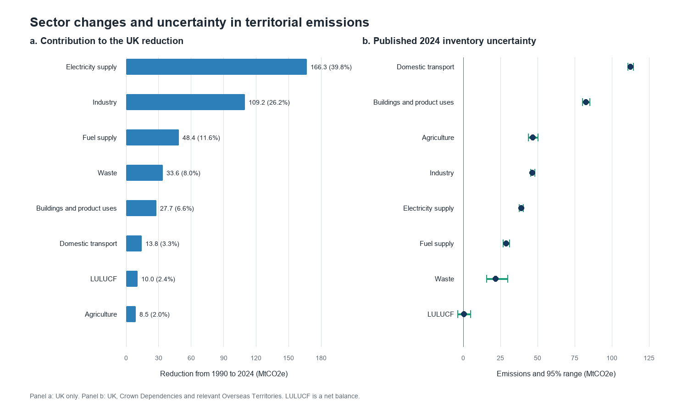
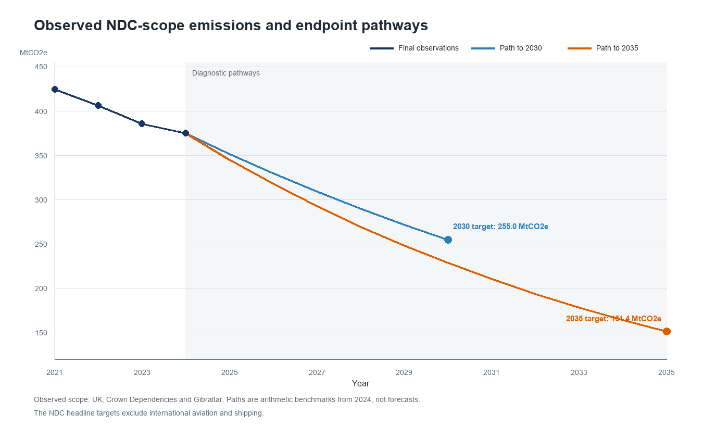

# UK greenhouse gas reductions and NDC pathways

This study asks two linked questions. Which source sectors account for the change in UK territorial greenhouse gas emissions between 1990 and 2024? How quickly would emissions in the scope of the Paris Agreement need to fall from the final 2024 estimate to reach the UK's 2030 and 2035 Nationally Determined Contributions (NDCs)?

The analysis uses the final 1990-2024 greenhouse gas statistics published by the Department for Energy Security and Net Zero (DESNZ). Historical observations, policy targets and simple diagnostic pathways are kept separate. The pathways are arithmetic benchmarks, not forecasts of policy delivery.

## Scope

- Sector analysis: UK territorial emissions by source sector, including net land use, land use change and forestry (LULUCF).
- Target analysis: emissions in scope of the Paris Agreement for the UK, Crown Dependencies and Gibraltar, as defined in DESNZ Table 2.2.
- Targets: at least 68% below the composite base year by 2030 and at least 81% below it by 2035.
- Exclusion: consumption emissions and international aviation and shipping are outside the NDC headline target.

The two geographical scopes are analysed separately. Sector totals are not used to reconstruct the NDC total.

## Current status

The study design, official data source, processing and first results are complete. The analysis extracts the published sector totals, keeps the different reporting scopes separate, evaluates the published uncertainty intervals and calculates transparent constant-absolute and constant-percentage pathways from the 2024 NDC-scope observation.

## Main findings

- UK territorial emissions fell by 417.4 MtCO2e, or 52.8%, between 1990 and 2024.
- Electricity supply and industry account for 66.0% of the net reduction.
- Domestic transport was the largest source sector in 2024 at 110.4 MtCO2e.
- The 2030 NDC threshold is 120.5 MtCO2e below the 2024 NDC-scope estimate. A constant compound pathway requires a 6.25% annual reduction.
- The corresponding compound rate to the 2035 threshold is 7.93% per year.

The calculations, uncertainty interpretation and figures are presented in [docs/findings.md](docs/findings.md).





## Run

```powershell
python scripts/prepare_analysis.py
python scripts/plot_results.py
python -m unittest discover -s tests -v
```

The script writes compact CSV tables to `outputs/tables`. Later steps will add scientific figures and an uncertainty assessment.

## Sources and licence

The source workbook is an Accredited Official Statistics release and is available under the Open Government Licence v3.0. Full URLs, attribution, retrieval date, scope notes and the source-file checksum are recorded in [docs/data-sources.md](docs/data-sources.md).

This repository is being developed locally. It has not been published to GitHub.

