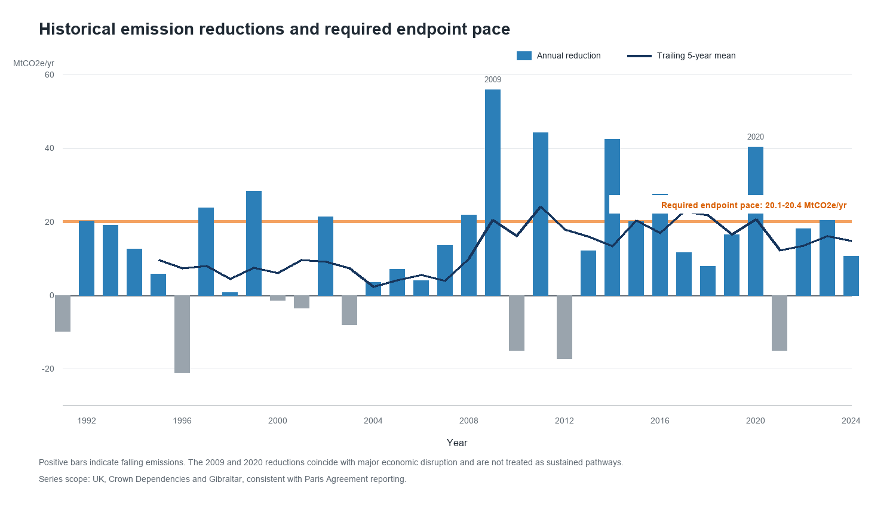

# Findings

## Change in UK territorial emissions

UK territorial greenhouse gas emissions fell from 790.8 MtCO2e in 1990 to 373.4 MtCO2e in 2024. This is a reduction of 417.4 MtCO2e, or 52.8%.

Electricity supply accounts for 166.3 MtCO2e, or 39.8%, of the net reduction. Industry accounts for a further 109.2 MtCO2e, or 26.2%. Fuel supply and waste contribute 48.4 MtCO2e and 33.6 MtCO2e respectively. Together, these four sectors account for 85.6% of the net reduction.

Domestic transport changed much less. Its emissions fell by 13.8 MtCO2e, or 11.1%, between 1990 and 2024. At 110.4 MtCO2e, it was the largest source sector in 2024. Buildings and product uses was second at 81.8 MtCO2e.

## NDC pathway diagnostics

Emissions in the scope of the Paris Agreement were 375.5 MtCO2e in 2024. The implied 2030 threshold is 255.0 MtCO2e, leaving a gap of 120.5 MtCO2e. Closing this gap from 2024 requires an average absolute reduction of 20.1 MtCO2e per year, or a constant compound reduction of 6.25% per year.

The implied 2035 threshold is 151.4 MtCO2e. The gap from 2024 is 224.1 MtCO2e. A constant endpoint pathway requires an average reduction of 20.4 MtCO2e per year, or 7.93% per year on a compound basis. The higher compound rate reflects the much lower 2035 endpoint.

These paths do not represent DESNZ projections or assumed policy delivery. They show the annual pace implied by the published endpoints.

## Historical pace comparison

The Paris Agreement scope series fell by an average of 15.8 MtCO2e per year from 2014 to 2024. The corresponding compound reduction was 3.45% per year. The absolute reduction required to reach the 2030 threshold is 20.1 MtCO2e per year, 27.0% above the 2014-2024 average. The 2035 endpoint requires 20.4 MtCO2e per year, 28.9% above that historical average.

The latest trailing five-year mean, measured from 2019 to 2024, was 14.9 MtCO2e per year. Individual annual changes were volatile. The large reductions in 2009 and 2020 coincided with the global financial crisis and the COVID-19 pandemic. They are observations, but they are not suitable templates for a sustained transition.

## Sector context

The composition of the remaining emissions differs from the composition of the historical reduction. Domestic transport accounted for 29.6% of UK territorial emissions in 2024 and buildings and product uses accounted for 21.9%. Electricity supply accounted for 10.1% after its large historical decline.

Between 2014 and 2024, electricity supply still contributed 55.2% of the UK-only reduction and industry contributed 17.9%. Domestic transport and buildings together contributed 15.7%. This indicates that extending the historical electricity-sector trend cannot deliver the national endpoints on its own. Further reductions must involve the large remaining transport and building sources, alongside continued change in industry, fuel supply and agriculture.

## Uncertainty

DESNZ reports a 2024 total of 378.1 MtCO2e in its uncertainty model, with a 95% range from 368.8 to 388.7 MtCO2e. This table covers the UK, Crown Dependencies and relevant Overseas Territories, so it is not numerically identical to either the UK-only source total or the NDC-scope total.

Relative uncertainty is low for domestic transport and higher for waste, agriculture and fuel supply. LULUCF has a wide interval around a near-zero net estimate, including both net removals and net emissions. This reflects uncertainty in the balance between land-sector sources and sinks. The reported intervals should not be transferred directly to the UK-only sector decomposition.

## Interpretation

The historical reduction is concentrated in electricity supply and industry. The remaining emissions profile is more dispersed, with domestic transport and buildings now prominent. The NDC endpoint calculations therefore describe a transition that cannot be inferred by simply extending the electricity-sector trend.

